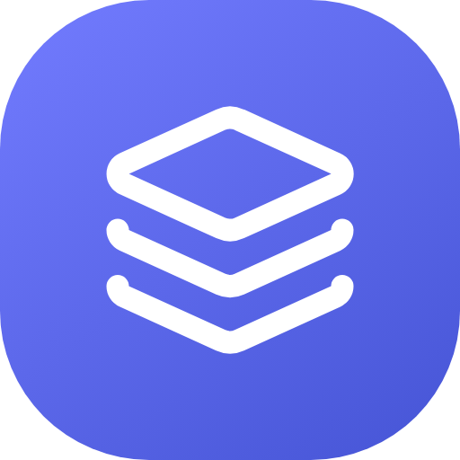

<p align="center">
  
</p>

<h1 align="center">aidesk</h1>

<p align="center">
  <strong>A shared support desk for solo developers and small teams: project-specific email, private customer portals, and AI that works under rules you set. REST and MCP included.</strong>
</p>

<p align="center">
  <a href="https://github.com/metaneutrons/aidesk/actions/workflows/ci.yml?query=branch%3Amain"></a>
  <a href="LICENSE"></a>
  
  
  
  
  <a href="docs/api/openapi.json"></a>
  <a href="https://modelcontextprotocol.io"></a>
</p>

---

## What it is

Support for several projects usually ends up in one shared mailbox, or in a helpdesk built for a company ten times the size. `aidesk` is the small version: one desk for up to ten projects and a handful of operators, where every project keeps its own sender address, mail design, customer page, permissions and rules.

The same operations are open to people, scripts and AI agents. The web interface, the REST API and the MCP server run on one set of operations, and what an agent may change is decided per project: under the default `review` policy an agent's changes to configuration, texts and connections are proposals that a person approves, and a project can switch to `direct` when it trusts its agents.

| Part | What it does |
|------|--------------|
| Shared desk | Dashboard, filtered inbox, search, tags, reminders, response clock, private notes, English and German interface |
| Email | IMAP or Cloudflare Email Routing in, SMTP or the Cloudflare Email Sending API out, threading, bounces, acknowledgements, junk handling, designed HTML and text mail |
| Customer portal | A private page per ticket reached through a personal link, with replies that arrive in the desk |
| REST API | A published [OpenAPI 3.1 definition](docs/api/openapi.json) generated from one route table |
| MCP server | Streamable HTTP with project-scoped bearer tokens; tools come from the same route table |
| Operations | Versioned configuration, texts and connections that people and agents can edit under the approval policy |

---

## Status

`aidesk` is under development and is not a production deployment. The first milestones are largely implemented and tested; real single sign-on providers, the AI execution layer, knowledge sources, production hosting and recovery are still open. The milestone issues track what is accepted and what is not:

- [Epic: aidesk v1](https://github.com/metaneutrons/aidesk/issues/1) with its five milestones
- [Epic: API definition and AI-editable configuration](https://github.com/metaneutrons/aidesk/issues/68)

Nothing here claims a feature the code does not have: the [capability ledger](docs/capabilities.md) lists, for every operation, which surfaces offer it and where they differ on purpose.

---

## Built for people and agents

Every operation exists once and is offered to whoever may use it:

```bash
# The published API definition needs no login
curl https://desk.example.test/api/v1/openapi.json

# An agent token is scoped to one project and to the actions it was issued with
curl -H "Authorization: Bearer $TOKEN" https://desk.example.test/api/v1/overview
```

- **One list of what can be done.** A route table names every route, the action it needs, its input and its response. The router, the API definition and the MCP tools are generated from it, and tests fail when they drift apart.
- **Agents are guests, not owners.** A token carries explicit actions for one project, never the right to issue tokens or to decide on proposals, and its secrets stay write-only.
- **Changes are versioned.** Configuration, texts and connections are written against the version that was read, can be validated without writing, and every change is audited and kept.
- **People decide what changes a project.** Under the `review` policy an agent's change waits for a person with the right to approve it, and a proposal made on a version that has since changed is refused.

---

## Documentation

| Document | Contents |
|----------|----------|
| [Development notes](docs/development.md) | Configuration, every feature in detail, evidence and known gaps |
| [API definition](docs/api/openapi.json) | OpenAPI 3.1 document, also served at `/api/v1/openapi.json` |
| [Guide for agents](docs/api/agent-guide.md) | What an agent reads first, and how versions, validation and proposals work; also served at `/api/v1/guide.md` |
| [Capability ledger](docs/capabilities.md) | Which surface offers which operation, and the reasons for differences |
| [Initial product plan](docs/plans/initial-product.md) | Scope, design decisions and acceptance criteria |
| [API and configuration plan](docs/plans/api-and-configuration.md) | The route table, the approval policy and editable configuration |
| [UX concept](docs/design/ux.md) | Desk, composing, portal and multilingual communication |
| [Contributing](CONTRIBUTING.md) | Planning convention, commits and checks |
| [Security policy](SECURITY.md) | How to report a vulnerability |

---

## Quick start

You need Docker with Compose v2 and OpenSSL.

```bash
git clone https://github.com/metaneutrons/aidesk.git
cd aidesk
sh scripts/dev.sh up --build -d
```

Open <http://localhost:3000> and sign in as `owner@aidesk.local`; the generated password is in `.env.development`. Mailpit at <http://localhost:8025> catches every outgoing mail. The stack is for development only and is not a production deployment.

## Local development

Install Docker with Compose v2 and OpenSSL, then run:

```sh
sh scripts/dev.sh up --build -d
```

Open `http://localhost:3000`. The local owner is `owner@aidesk.local`; read its
generated password from `.env.development` on your own machine and keep that
file private. Mailpit captures outgoing mail at `http://localhost:8025`, without
an external relay. Object storage is [PGSTY Silo](https://github.com/pgsty/silo),
an S3-compatible MinIO fork; its console is at `http://localhost:9001` with the
`S3_ACCESS_KEY`/`S3_SECRET_KEY` pair from `.env.development`. PostgreSQL, Silo and
dependency caches use named volumes. PostgreSQL and the S3 API are reachable only
inside the Compose network. Editing `src/` reloads the app.

MCP and REST clients that need TLS use `https://localhost:8443` (Caddy with a
local CA); `sh scripts/dev.sh https-ca` prints the root certificate to trust. See
the [development notes](docs/development.md) for issuing project-scoped tokens.

A development Keycloak at `http://localhost:8080` provides real OIDC and SAML
sign-in (realm `aidesk`; admin user `admin` with `KEYCLOAK_ADMIN_PASSWORD`). On
the sign-in page, enter an IdP email and choose Continue with SSO. The IdP
accounts use `DEV_SSO_USER_PASSWORD`: `alice@oidc.aidesk.test` signs in through
OIDC as an Orbit operator, `bob@saml.aidesk.test` through SAML with read and note
access to Harbor, and `mallory@oidc.aidesk.test` has no aidesk account and is
refused. `scripts/dev.sh` adds missing development secrets to an existing
`.env.development` without changing present values.

```sh
sh scripts/dev.sh exec -T app pnpm lint
sh scripts/dev.sh exec -T app pnpm typecheck
sh scripts/dev.sh exec -T app pnpm check:catalogs
sh scripts/dev.sh exec -T app pnpm test --coverage
sh scripts/dev.sh exec -T -e NODE_ENV=production -e NEXT_DIST_DIR=.next-production app pnpm build
sh scripts/dev.sh down
```

Browser tests run on the host against the running stack. Install the browsers once
with `pnpm exec playwright install chromium firefox webkit`, then run `pnpm
test:e2e`. Each Playwright worker creates its own operator and projects under an
`e2e-` prefix inside the app container (`scripts/e2e-fixture.ts`) and deletes them
afterwards, so the development desk data stays unchanged. CI runs them in the
Browser tests job against the same Compose stack.

Stopping the stack preserves data. Integration tests use `aidesk_test`, separate
from the development desk. The bootstrap creates two persisted example projects
once and preserves later configuration. Generated credentials are for private
development; this Compose file is not a production deployment.

For host tooling use Node 26 and the package's pinned standalone pnpm, then `pnpm
install --frozen-lockfile`. Lefthook installs the Git hooks; install Gitleaks
before committing or pushing. Without a host `DATABASE_URL`, the pre-push hook
runs the tests inside the running app container. If the host creates or replaces
`node_modules` while the stack runs, recreate the containers with `sh
scripts/dev.sh up -d --force-recreate app worker`. Some bind-mount implementations
(observed with Colima, a Lima VM with virtiofs, on Apple Silicon) then detach the
container's dependency volume and expose host-platform packages; the pre-push hook
detects this and stops. CI runs only on Node 26. See the [development
handoff](docs/development.md) for configuration, evidence and gaps. For the move
from cloud to a local machine, use the [local implementation
handoff](docs/handoff-local.md), including a continuation prompt for the next
agent.

---

## Contributing

Work is planned in versioned plans and tracked in milestone issues; see [CONTRIBUTING.md](CONTRIBUTING.md). Commits follow Conventional Commits, and a pull request carries one kind of change. Report security problems as described in [SECURITY.md](SECURITY.md).

## License

`aidesk` is licensed under the GNU General Public License v3.0 or later. See [LICENSE](LICENSE).
